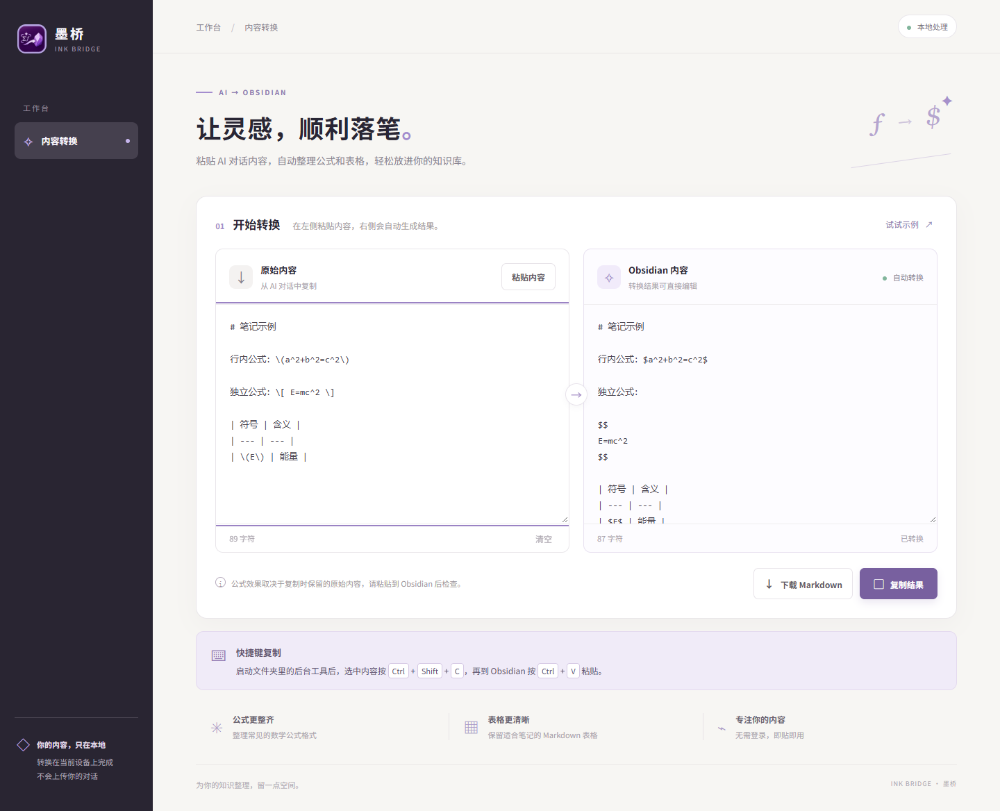

# 墨桥 Ink Bridge

把 AI 对话中的文字、公式和表格整理成适合 Obsidian 的 Markdown。选中内容后按一次快捷键，转换完成后即可粘贴；也可以在转换页面预览、编辑和下载结果。



## 功能

- **快捷键转换**：在原页面选中内容，按 `Ctrl + Shift + C` 复制并转换，再到 Obsidian 粘贴。
- **公式和表格**：整理常见的 LaTeX 公式分隔符，尽量从富文本中提取公式源码，并转换常见表格。
- **预览和编辑**：转换页面支持粘贴、修改结果、复制和下载 Markdown 文件。
- **本地处理**：转换在自己的电脑上完成，无需登录，也不会上传对话内容。

## 下载与启动

目前提供 **64 位 Windows 10 / 11 便携版**。

1. 前往 [Releases](https://github.com/Inertia-Life/inkbridge-obsidian/releases/latest) 下载 Windows 便携版压缩包。
2. 将压缩包**完整解压**，保留文件夹内所有文件。
3. 双击解压后的 `墨桥.exe`。程序会在浏览器中打开转换页面，并在 Windows 通知区域运行快捷键工具。

便携版已包含所需运行组件，无需单独安装 Node.js，日常使用也不需要联网。转移到另一台兼容的 Windows 电脑时，请复制整个压缩包或解压后的整个文件夹。

## 使用快捷键

1. 在 AI 对话中选中要复制的内容。
2. 按 `Ctrl + Shift + C`，松开按键，等待“转换完成”提示。
3. 到 Obsidian 按 `Ctrl + V` 粘贴。

如果快捷键已被其他软件占用，请先关闭占用该快捷键的软件。工具图标位于任务栏通知区域，可能收在“显示隐藏的图标”中；右键图标可重新打开转换页面或退出。重启电脑后需要重新启动墨桥。

## 使用转换页面

1. 从 AI 对话中复制内容。
2. 在左侧输入框按 `Ctrl + V` 粘贴，右侧会自动生成结果。
3. 按需编辑右侧结果，点击“复制结果”后粘贴到 Obsidian，或点击“下载 Markdown”保存为 `.md` 文件。

如果浏览器不允许“粘贴内容”按钮读取剪贴板，请直接在左侧输入框按 `Ctrl + V`。再次编辑左侧内容会重新生成右侧结果。

## 支持范围

墨桥支持整理常见的 `\(...\)`、`\[...\]` 和 `$...$` / `$$...$$` 公式格式，并尝试提取部分 AI 页面富文本中保留的公式源码。不同平台复制的内容有所差异；若原始复制内容没有保留公式源码，或包含复杂表格、图片、嵌套结构，结果可能需要手动调整。建议粘贴到 Obsidian 后检查显示效果。

当前提供的全局快捷键程序适用于 Windows；macOS 和 Linux 的快捷键版本尚未制作或验证。转换页面可直接在浏览器中打开，但其他平台的使用效果尚未完整验证。

## 从源码运行

只使用页面时，可直接用浏览器打开 `index.html`。如需运行转换测试，在安装 Node.js 后执行：

```powershell
npm ci
node --test conversion.test.js
```

在 64 位 Windows 上可使用 PowerShell 7 运行 `build-portable.ps1` 构建便携包。构建需要 Node.js、.NET Framework 编译器，以及网络连接以获取 Node.js 许可证；生成的文件位于 `dist` 目录。

便携包中的 Node.js 和其他第三方组件许可证分别位于 `runtime/NODE-LICENSE.txt` 和 `node_modules` 内各组件的目录中。
